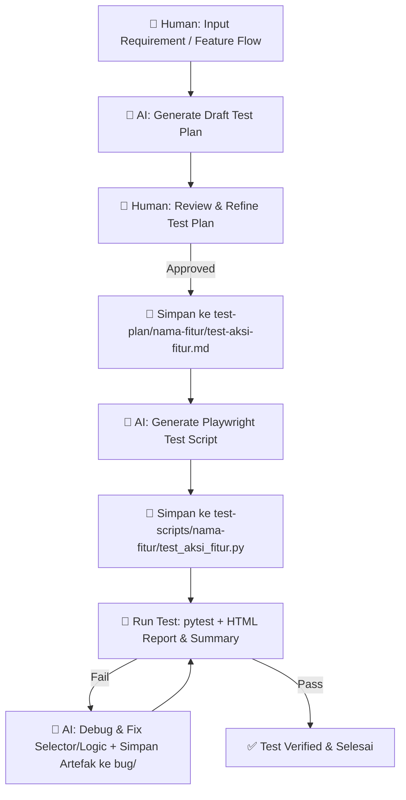

# 🤖 AI-Driven QA Testing Workflow — SGS (DEV)

Repositori ini menerapkan alur kerja pengujian otomatis (*Automated QA Testing Workflow*) berbasis AI untuk **SGS CMS & Web (DEV Environment)** dengan kolaborasi:

- 🧠 **Test Plan**: Dibuat secara kolaboratif oleh **Human + AI**.
- ⚡ **Test Script**: Dibuat secara otomatis oleh **AI** (Playwright Python).
- 📊 **Reporting & Bug Tracking**: HTML report + screenshot otomatis saat test gagal.

---

## 🌐 Target Environment

| Platform | URL |
|---|---|
| CMS (DEV) | https://sgs-cms-dev.qode.biz.id |
| Web (DEV) | https://sgs-web-dev.qode.biz.id |

---

## 📌 Alur Kerja (Workflow Diagram)



---

## 📁 Struktur Direktori

```
testing-sgs/
├── data/                    # Konfigurasi & kredensial dinamis
│   ├── config.py            # Base URLs
│   └── account_development.py  # Kredensial dari env variable
├── test-plan/               # Dokumentasi skenario pengujian (Human + AI)
│   ├── login/
│   │   └── test-login.md
│   └── dashboard/
│       └── test-dashboard.md
├── test-scripts/            # Script pengujian Playwright (AI Generated)
│   ├── login/
│   │   └── test_login.py
│   └── dashboard/
│       └── test_dashboard.py
├── bug/                     # Screenshot & log otomatis saat test fail (di-gitignore)
├── utils/
│   └── playwright_helpers.py  # Helper reusable (login, navigasi)
├── conftest.py              # Fixtures global + hook screenshot on failure
├── pytest.ini               # Konfigurasi Pytest
├── requirements.txt
└── README.md
```

---

## 📦 Instalasi

```bash
# 1. Clone repo
git clone https://github.com/maryam-silva/testing-sgs.git
cd testing-sgs

# 2. Buat & aktifkan virtual environment
python -m venv .venv
# Windows:
.venv\Scripts\activate
# macOS/Linux:
source .venv/bin/activate

# 3. Install dependencies
pip install -r requirements.txt
playwright install
```

---

## 🔐 Konfigurasi Kredensial

Set password via environment variable (**jangan pernah hardcode di script**):

```powershell
# Windows PowerShell
$env:SGS_CMS_EMAIL = "auto@test.id"
$env:SGS_CMS_PASSWORD = "your-password"
```

```bash
# macOS / Linux
export SGS_CMS_EMAIL="auto@test.id"
export SGS_CMS_PASSWORD="your-password"
```

---

## 🚀 Menjalankan Test

```bash
# Semua test
pytest

# Dengan HTML report
pytest --html=report.html --self-contained-html

# File spesifik
pytest test-scripts/login/test_login.py

# Mode headed (browser terlihat) — cocok untuk debugging
pytest --headed --slowmo=500

# Headed + HTML report
pytest --headed --html=report.html --self-contained-html
```

---

## 📂 Bug Artifacts Otomatis

Jika test gagal, `conftest.py` otomatis menyimpan:

```
bug/
└── login/
    └── 17-11-2026_14.30/
        ├── screenshot.png
        └── error.log
```

---

## 🎯 Best Practices

1. **Jangan hardcode password** — selalu gunakan environment variable.
2. **Prioritaskan accessibility locators**: `get_by_role`, `get_by_label`, `get_by_text`.
3. **Satu Test Case ID = Satu fungsi test** agar mudah ditelusuri ke test plan.
4. **Review manual** hasil draft AI terhadap aplikasi asli sebelum commit.
5. **Pantau `report.html` dan folder `bug/`** setelah setiap eksekusi.
