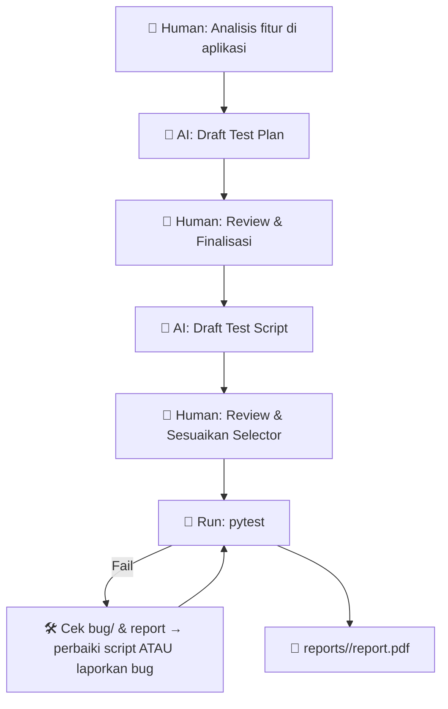

# SGS DEV — Playwright Python Automation Testing

Automation test *end-to-end* (E2E) untuk **SGS** (CMS + website).
Setiap run otomatis menghasilkan **PDF report** + progress realtime, plus screenshot & log untuk setiap test yang gagal.

| Item | Detail |
| --- | --- |
| Environment | **development** |
| Website | https://sgs-web-dev.qode.biz.id |
| CMS | https://sgs-cms-dev.qode.biz.id |
| Stack | Python 3.10+ · Playwright · Pytest (`pytest-playwright`) |
| Browser | Chromium (viewport desktop 1280×720) |

---

## 📑 Daftar Isi

1. [Alur Kerja](#-alur-kerja)
2. [Struktur Direktori](#-struktur-direktori)
3. [Instalasi](#-instalasi-windows-powershell)
4. [Konfigurasi Kredensial](#-konfigurasi-kredensial)
5. [Menjalankan Test](#-menjalankan-test)
6. [Hasil Run: Report & Artefak Bug](#-hasil-run-report--artefak-bug)
7. [Menambah Test Baru](#-menambah-test-baru)
8. [Konvensi](#-konvensi)
9. [Troubleshooting](#-troubleshooting)

---

## 📌 Alur Kerja



1. **Test plan** (`test-plan/**/*.md`) adalah sumber kebenaran skenario pengujian (Pre-condition, Steps, Expected Result).
2. **Test script** (`test-scripts/**/test_*.py`) mengimplementasikan setiap TC ID di test plan (1 TC ID = 1 fungsi test).
3. **Run** → hasilnya PDF report + `progress.txt` realtime + screenshot/log bug otomatis.
4. **Analisis kegagalan**: test FAIL belum tentu bug aplikasi — cek screenshot di `bug/` dulu.
   - Selector/timing/server lambat → perbaiki script.
   - Aplikasinya memang salah → catat di bug report.

---

## 📁 Struktur Direktori

```
sgs-dev/
├── .env                        # credential lokal (TIDAK di-commit)
├── .gitignore
├── conftest.py                 # fixture global + hook screenshot on failure + PDF report
├── pytest.ini                  # konfigurasi pytest (base-url, timeout, reruns)
├── requirements.txt
├── data/
│   ├── config.py               # base URL CMS & Web
│   ├── account_development.py  # kredensial dari env variable
│   └── cms_data.py             # test data CMS (auto-prefix [AUTO])
├── test-plan/
│   ├── login/test-login.md
│   ├── dashboard/test-dashboard.md
│   ├── articles/test-articles.md
│   └── web/test-web.md
├── test-scripts/
│   ├── login/test_login.py         # TP-LOGIN-*  (CMS login)
│   ├── dashboard/test_dashboard.py # TP-DASH-*   (CMS dashboard)
│   ├── articles/test_articles.py   # TP-ART-*    (CMS articles CRUD + cross-check)
│   └── web/test_web.py             # TP-WEB-*    (website frontend)
├── utils/
│   ├── playwright_helpers.py   # helper reusable (login CMS, navigasi)
│   └── pdf_report.py           # generator PDF dari results.json
├── bug/                        # (auto, tidak di-commit) <fitur>/<DD-MM-YYYY_HH.MM>/
│   ├── screenshot.png
│   └── error.log
└── reports/                    # (auto, tidak di-commit) <DD-MM-YYYY_HH.MM>/
    ├── progress.txt             # update realtime saat test berjalan
    ├── results.json             # raw data semua hasil
    └── report.pdf               # PDF report final
```

> Folder `bug/` dan `reports/` adalah hasil run dan ada di `.gitignore`. Jangan di-commit.

---

## 📦 Instalasi (Windows PowerShell)

**Prasyarat:** Python 3.10+, Git.

```powershell
git clone <repo-url>
cd sgs-dev
python -m venv .venv
.venv\Scripts\activate
pip install -r requirements.txt
playwright install chromium
pytest --collect-only -q      # verifikasi instalasi
```

> Kalau `.venv\Scripts\activate` diblok PowerShell: `Set-ExecutionPolicy -Scope CurrentUser RemoteSigned`

---

## 🔐 Konfigurasi Kredensial

Buat file `.env` di root project (sudah ada di `.gitignore` — **jangan di-commit**):

```
SGS_CMS_EMAIL=auto@test.id
SGS_CMS_PASSWORD=your-password
```

Atau set langsung via environment variable:

```powershell
# Windows PowerShell
$env:SGS_CMS_EMAIL = "auto@test.id"
$env:SGS_CMS_PASSWORD = "your-password"
```

**Jangan pernah hardcode password di script atau test plan.**

---

## 🚀 Menjalankan Test

Pastikan venv aktif (`.venv\Scripts\activate`), lalu pilih salah satu perintah di bawah.

### Full Run (semua modul)

```powershell
pytest
```

### Per Modul

```powershell
pytest test-scripts/login/           # semua TC login
pytest test-scripts/dashboard/       # semua TC dashboard
pytest test-scripts/articles/        # semua TC articles (CMS CRUD + cross-check)
pytest test-scripts/web/             # semua TC website frontend
```

### Per Test Case (satu TC ID)

Cocokkan bagian nama fungsi menggunakan flag `-k`:

```powershell
pytest -k "test_login_success"                   # satu test case spesifik
pytest -k "test_create_article"                  # test create article
pytest -k "test_homepage_loads"                  # test homepage web
```

> Nama fungsi mengikuti TC ID: `TP-LOGIN-01` → `test_login_success`, `TP-ART-02` → `test_create_article`, dst.

### Per Marker

Setiap test ditandai marker untuk memudahkan filter:

| Marker | Deskripsi |
| --- | --- |
| `cms` | Semua test CMS (login, dashboard, articles) |
| `web` | Semua test website frontend |
| `smoke` | Health check cepat — jalankan sebelum full run |
| `crud` | Test yang membuat/mengubah/menghapus data (auto-cleanup) |
| `cross_check` | Verifikasi perubahan CMS tampil di web |

```powershell
pytest -m smoke                      # smoke test semua modul (cepat)
pytest -m cms                        # semua test CMS
pytest -m web                        # semua test website
pytest -m crud                       # semua test CRUD CMS
pytest -m cross_check                # semua test cross-check CMS ↔ web
pytest -m "cms and not crud"         # CMS tapi bukan yang CRUD
pytest -m "smoke or cross_check"     # gabungan marker
```

### Mode Debug (lihat browser)

```powershell
pytest --headed                      # browser tampil
pytest --headed --slowmo=500         # browser tampil + diperlambat 500ms
pytest --headed -k "test_create_article"   # debug satu TC
```

### Collect Only (cek tanpa run)

```powershell
pytest --collect-only -q             # daftar semua TC yang akan dijalankan
pytest --collect-only -q -m smoke    # daftar TC smoke saja
```

---

## 📄 Hasil Run: Report & Artefak Bug

### Progress Realtime

Saat test berjalan, buka file berikut untuk melihat progress:

```
reports/<DD-MM-YYYY_HH.MM>/progress.txt
```

Contoh isi:
```
SGS DEV — Test Progress
Started : 17/11/2026 18:10:00
Total TC: 42
------------------------------------------------------------
[+]   1/ 42  ( 2%)  PASSED   test-scripts/login/test_login.py::test_login_success[chromium]
[!]   2/ 42  ( 4%)  FAILED   test-scripts/dashboard/test_dashboard.py::test_dashboard_loads[chromium]
...
------------------------------------------------------------
Finished: 17/11/2026 18:15:30
Summary : 38 passed  1 flaky  2 failed  1 skipped
```

### PDF Report

Setelah run selesai, PDF otomatis dibuat:

```
reports/<DD-MM-YYYY_HH.MM>/report.pdf
```

### Artefak Bug (screenshot & log)

Setiap test yang FAILED otomatis menyimpan:

```
bug/<fitur>/<DD-MM-YYYY_HH.MM>/
├── screenshot.png    # screenshot saat test gagal
└── error.log         # traceback lengkap
```

---

## ➕ Menambah Test Baru

1. **Test plan:** buat file baru di `test-plan/<fitur>/test-<fitur>.md`. Isi tabel test case dengan kolom:
   `Test Case ID | Title | Pre-conditions | Test Steps | Expected Result | Priority`.
   Format TC ID: `TP-<MODUL>-<NNN>`, contoh `TP-LOGIN-01`.

2. **Test script:** buat file baru di `test-scripts/<fitur>/test_<fitur>.py`.

3. Tulis 1 fungsi per TC ID:
   ```python
   @pytest.mark.cms
   def test_login_success(page: Page):
       """TP-LOGIN-01: Login berhasil dengan kredensial valid"""
       ...
   ```

4. Gunakan fixture `page` / `cms_page` / `web_page` dari `conftest.py` sesuai kebutuhan:
   - `page` — fresh page di CMS base URL (untuk login, navigasi umum)
   - `cms_page` — page yang sudah login ke CMS (untuk CRUD)
   - `web_page` — page di website SGS (untuk frontend test)
   - `cms_web_pages` — tuple `(cms_page, web_page)` (untuk cross-check)

5. Jalankan `pytest -k <nama_fungsi> --headed` sampai stabil, lalu jalankan modulnya secara penuh.

6. Untuk merekam selector: `playwright codegen --target python https://sgs-cms-dev.qode.biz.id`, lalu rapikan mengikuti konvensi di bawah.

---

## 🎯 Konvensi

- **1 TC ID = 1 fungsi test**, nama fungsi diawali ID: `test_login_success` ↔ `TP-LOGIN-01`.
- Locator: utamakan `get_by_role` / `get_by_label` / `get_by_placeholder` / `get_by_text`. Hindari CSS/XPath yang rapuh.
- Credential selalu dari env variable lewat `data/account_development.py` — **jangan pernah hardcode**.
- Data test CMS selalu berawalan `[AUTO]` via `auto()` di `data/cms_data.py` dan dihapus di teardown.
- Screenshot saat gagal sudah otomatis dari `conftest.py`, tidak perlu ditulis ulang di script.
- Setiap test harus bisa dijalankan secara independen (tidak bergantung urutan atau state test lain).

---

## 🛠️ Troubleshooting

| Masalah | Solusi |
| --- | --- |
| `ModuleNotFoundError` | venv belum aktif — jalankan `.venv\Scripts\activate` |
| Browser tidak ditemukan | Jalankan `playwright install chromium` |
| Test gagal karena elemen tidak ditemukan | Buka screenshot di `bug/`, jalankan `--headed`, atau rekam ulang selector dengan `playwright codegen` |
| `WinError 32` saat `pip install` | File dikunci OneDrive — pause sync sebentar lalu ulangi |
| Password tidak terbaca | Pastikan env variable sudah di-set atau file `.env` sudah dibuat di root project |
| PDF tidak terbuat | Cek `pip install reportlab` sudah terinstall |
