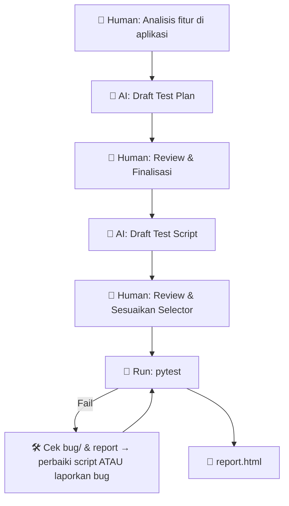

# 🧪 SGS DEV — Playwright Python Automation Testing

Automation test *end-to-end* (E2E) untuk **SGS** (CMS + website).
Setiap run otomatis menghasilkan **HTML report** siap review, plus screenshot & log untuk setiap test yang gagal.

| Item | Detail |
| --- | --- |
| Environment | **development** |
| Website | https://sgs-web-dev.qode.biz.id |
| CMS | https://sgs-cms-dev.qode.biz.id |
| Stack | Python 3.10+ · Playwright · Pytest (`pytest-playwright`) · `pytest-html` |
| Browser | Chromium (viewport desktop 1280×720) |

---

## 📑 Daftar Isi

1. [Alur Kerja](#-alur-kerja)
2. [Struktur Direktori](#-struktur-direktori)
3. [Instalasi](#-instalasi-windows-powershell)
4. [Konfigurasi Kredensial](#-konfigurasi-kredensial)
5. [Menjalankan Test](#-menjalankan-test)
6. [Hasil Run: HTML Report & Artefak Bug](#-hasil-run-html-report--artefak-bug)
7. [Menambah Test Baru](#-menambah-test-baru)
8. [Konvensi](#-konvensi)
9. [Troubleshooting](#-troubleshooting)

---

## 📌 Alur Kerja



1. **Test plan** (`test-plan/**/*.md`) adalah sumber kebenaran skenario pengujian (Pre-condition, Steps, Expected Result).
2. **Test script** (`test-scripts/**/test_*.py`) mengimplementasikan setiap TC ID di test plan (1 TC ID = 1 fungsi test).
3. **Run** → hasilnya HTML report + screenshot/log bug otomatis.
4. **Analisis kegagalan**: test FAIL belum tentu bug aplikasi — cek screenshot di `bug/` dulu.
   - Selector/timing/server lambat → perbaiki script.
   - Aplikasinya memang salah → catat di bug report.

---

## 📁 Struktur Direktori

```
testing-sgs/
├── .env                        # credential lokal (TIDAK di-commit)
├── .gitignore
├── conftest.py                 # fixture global + hook screenshot on failure
├── pytest.ini                  # konfigurasi pytest (base-url, timeout)
├── requirements.txt
├── data/
│   ├── config.py               # base URL CMS & Web
│   └── account_development.py  # kredensial dari env variable
├── test-plan/
│   ├── login/
│   │   └── test-login.md
│   └── dashboard/
│       └── test-dashboard.md
├── test-scripts/
│   ├── login/
│   │   └── test_login.py
│   └── dashboard/
│       └── test_dashboard.py
├── utils/
│   └── playwright_helpers.py   # helper reusable (login CMS, navigasi)
├── bug/                        # (otomatis, tidak di-commit) <fitur>/<DD-MM-YYYY_HH.MM>/screenshot.png + error.log
└── report.html                 # (otomatis, tidak di-commit) hasil run terakhir
```

> Folder `bug/` dan `report.html` adalah hasil run dan ada di `.gitignore`. Jangan di-commit.

---

## 📦 Instalasi (Windows PowerShell)

**Prasyarat:** Python 3.10+, Git.

```powershell
git clone https://github.com/maryam-silva/testing-sgs.git
cd testing-sgs
python -m venv .venv
.venv\Scripts\activate
pip install -r requirements.txt
playwright install chromium
pytest --collect-only -q      # verifikasi instalasi
```

> Kalau `.venv\Scripts\activate` diblok PowerShell: `Set-ExecutionPolicy -Scope CurrentUser RemoteSigned`

---

## 🔐 Konfigurasi Kredensial

Buat file `.env` di root project (sudah ada di `.gitignore` — **jangan di-commit**):

```
SGS_CMS_EMAIL=auto@test.id
SGS_CMS_PASSWORD=your-password
```

Atau set langsung via environment variable:

```powershell
# Windows PowerShell
$env:SGS_CMS_EMAIL = "auto@test.id"
$env:SGS_CMS_PASSWORD = "your-password"
```

```bash
# macOS / Linux
export SGS_CMS_EMAIL="auto@test.id"
export SGS_CMS_PASSWORD="your-password"
```

**Jangan pernah hardcode password di script atau test plan.**

---

## 🚀 Menjalankan Test

Pastikan venv aktif (`.venv\Scripts\activate`), lalu:

```powershell
pytest                                              # semua test + HTML report
pytest test-scripts/login/                         # satu modul
pytest test-scripts/login/test_login.py            # satu file
pytest -k "tp_login_01"                            # satu TC (cocokkan sebagian nama fungsi)
pytest --headed --slowmo=500                       # lihat browser jalan (debug)
pytest --html=report.html --self-contained-html    # generate HTML report manual
```

---

## 📄 Hasil Run: HTML Report & Artefak Bug

### HTML Report

```powershell
pytest --html=report.html --self-contained-html
```

Buka `report.html` di browser untuk melihat ringkasan hasil run per test case.

### Artefak bug (screenshot & log)

Setiap test yang FAILED otomatis menyimpan:

```
bug/<fitur>/<DD-MM-YYYY_HH.MM>/
├── screenshot.png    # screenshot saat test gagal
└── error.log         # traceback lengkap
```

---

## ➕ Menambah Test Baru

1. **Test plan:** buat file baru di `test-plan/<fitur>/test-<fitur>.md`. Isi tabel test case dengan kolom:
   `Test Case ID | Title | Pre-conditions | Test Steps | Expected Result | Priority`.
   Format TC ID: `TP-<MODUL>-<NNN>`, contoh `TP-LOGIN-01`.

2. **Test script:** buat file baru di `test-scripts/<fitur>/test_<fitur>.py`.

3. Tulis 1 fungsi per TC ID:
   ```python
   # TP-LOGIN-01
   def test_login_success(page: Page):
       ...
   ```

4. Pakai fixture `page` dari `conftest.py` dan helper dari `utils/playwright_helpers.py`.

5. Jalankan `pytest -k <nama_fungsi> --headed` sampai stabil, lalu jalankan modulnya secara penuh.

6. Untuk merekam selector: `playwright codegen --target python https://sgs-cms-dev.qode.biz.id`, lalu rapikan mengikuti konvensi di bawah.

---

## 🎯 Konvensi

- **1 TC ID = 1 fungsi test**, nama fungsi diawali ID: `test_login_success` ↔ `TP-LOGIN-01`.
- Locator: utamakan `get_by_role` / `get_by_label` / `get_by_placeholder` / `get_by_text`. Hindari CSS/XPath yang rapuh.
- Credential selalu dari env variable lewat `data/account_development.py` — **jangan pernah hardcode**.
- Screenshot saat gagal sudah otomatis dari `conftest.py`, tidak perlu ditulis ulang di script.
- Setiap test harus bisa dijalankan secara independen (tidak bergantung urutan atau state test lain).

---

## 🛠️ Troubleshooting

| Masalah | Solusi |
| --- | --- |
| `ModuleNotFoundError` | venv belum aktif — jalankan `.venv\Scripts\activate` |
| Browser tidak ditemukan | Jalankan `playwright install chromium` |
| Test gagal karena elemen tidak ditemukan | Buka screenshot di `bug/`, jalankan `--headed`, atau rekam ulang selector dengan `playwright codegen` |
| `WinError 32` saat `pip install` | File dikunci OneDrive — pause sync sebentar lalu ulangi |
| Password tidak terbaca | Pastikan env variable sudah di-set atau file `.env` sudah dibuat di root project |
