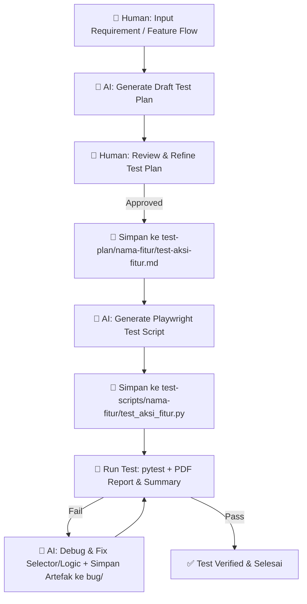

Salin text dibawah menjadi file readme. lalu sesuaikan dengan project yang akan di buat test script nya:

# 🤖 AI-Driven QA Testing Workflow (Playwright)

Repositori ini menerapkan alur kerja pengujian otomatis (*Automated QA Testing Workflow*) berbasis AI untuk **[NAMA PROJECT/CMS]** dengan kolaborasi:

- 🧠 **Test Plan**: Dibuat secara kolaboratif oleh **Human + AI** (Human memberikan konteks/kebutuhan bisnis, AI menyusun skenario detail, Human mereview dan menyetujui).
- ⚡ **Test Script**: Dibuat secara otomatis oleh **AI** (AI mengonversi Test Plan menjadi script Playwright Python).
- 📊 **Reporting & Bug Tracking**: Pelaporan hasil tes otomatis menggunakan laporan PDF (`reports/<timestamp>/report.pdf`) dan JSON (`results.json`) yang digenerate otomatis oleh `conftest.py` setelah setiap sesi pytest, serta dokumentasi kegagalan (*bug*) terstruktur per fitur dan waktu eksekusi.

---

## 📌 Alur Kerja (Workflow Diagram)



---

## 📁 Struktur Direktori

```
testing-[nama-project]/
├── data/                    # Konfigurasi & kredensial dinamis (config.py, account_development.py, account_staging.py)
├── test-plan/              # Dokumentasi skenario pengujian (Human + AI), dikelompokkan per fitur
│   ├── login/
│   │   └── test-login.md
│   ├── setting/
│   │   └── test-setting.md
│   └── schedule/
│       └── test-schedule.md
├── test-scripts/           # Script pengujian Playwright (AI Generated), dikelompokkan per fitur
│   ├── login/
│   │   └── test_login.py
│   ├── setting/
│   │   └── test_setting.py
│   └── schedule/
│       └── test_schedule.py
├── bug/                    # Dokumentasi otomatis saat test fail (screenshot/log), dikelompokkan per waktu eksekusi
│   ├── login/
│   │   └── 14-04-2026_15.30/
│   │       ├── error.log
│   │       └── screenshot.png
│   ├── setting/
│   │   └── 14-04-2026_15.30/
│   │       ├── error.log
│   │       └── screenshot.png
│   └── schedule/
│       └── 14-04-2026_15.30/
│           ├── error.log
│           └── screenshot.png
├── reports/                # Laporan hasil pengujian (PDF + JSON), dikelompokkan per timestamp eksekusi
│   └── 14-04-2026_15.30/
│       ├── results.json    # Data lengkap semua test (status, durasi, screenshot path)
│       └── report.pdf      # Laporan PDF siap kirim
├── conftest.py             # Fixtures global (browser, context, page, base_url, hook pelaporan bug & summary)
├── pytest.ini              # Konfigurasi Pytest (base-url, browser, timeout)
├── requirements.txt
└── README.md               # Dokumentasi workflow & template prompt
```

---

## 🔄 Tahapan Workflow & Contoh Prompt

### Tahap 1: Pembuatan Test Plan (Human + AI)

Human memberikan ringkasan fitur, alur pengguna, atau *acceptance criteria*, lalu meminta AI untuk mengembangkan skenario pengujian yang mencakup *positive case*, *negative case*, dan *edge case*.

#### 📝 Template Prompt Test Plan:

```
Bertindaklah sebagai Senior QA Automation Engineer.
Saya ingin membuat Test Plan untuk fitur [NAMA FITUR] pada aplikasi [NAMA PROJECT].

Konteks Fitur & Alur Bisnis:
- Target URL: [URL / PATH]
- Deskripsi Alur: [JELASKAN ALUR PENGGUNAAN SINGKAT]
- Kredensial / Data Test: [USERNAME, PASSWORD, ROLE, DLL]

Tolong buatkan Test Plan dalam format Markdown yang mencakup:
1. Preconditions & Test Data
2. Positive Test Cases (Happy Path)
3. Negative Test Cases (Validation, Salah Input, Unauthorized)
4. Edge Cases / Boundary Tests
5. Expected Results pada setiap step

Format output harus ringkas, jelas, dan mudah dikonversi menjadi automation script.
```

---

#### 💡 Contoh Prompt Riil (Fitur Login):

```
Bertindaklah sebagai Senior QA Engineer.
Buatkan Test Plan detail untuk pengujian fitur Login di [NAMA PROJECT] ([TARGET URL]).

Detail:
- Akun valid: [USERNAME] / [PASSWORD]
- Expected: Berhasil redirect ke dashboard dan URL tidak lagi mengandung halaman login.
- Tolong sertakan skenario:
  1. Happy path (login berhasil).
  2. Login gagal (password salah).
  3. Validasi form kosong (email/password belum diisi).
  4. Format email/username tidak valid.
```

---

#### 💡 Contoh Prompt Riil Kompleks (Fitur Account Settings - RTM / Table Format):

```
Buatkan dokumentasi Test Plan lengkap untuk fitur Account Settings (/app/setting) dalam format Markdown untuk file test-plan/setting/test-setting.md.

Pastikan Test Plan mencakup detail skenario berikut yang dikelompokkan ke dalam Positif Case, Negatif Case, dan Edge Case dalam bentuk tabel RTM (Requirement Traceability Matrix) / format terstruktur memuat: Test Case ID, Title, Pre-conditions, Test Steps, Expected Result, dan Priority (High/Medium/Low).

Catatan Pelaksanaan:
- TC yang failed otomatis di-screenshot ke bug/<tanggal_jam-menit>/<nama-tc>.jpg (hook global di conftest.py, lihat AGENTS.md § 4.4). Tidak perlu logic tambahan di file test nya.
- File ditaruh di folder test-plan/setting/test-setting.md.

Skenario Rujukan:
Positif Case:
- TP-SET-01: Tampilan Struktur Menu Account Settings (Personal, Payout, Referral)
- TP-SET-02: Tampilan Lengkap Profil Akun Dokter (nama, telp, spesialisasi, data diri)
- TP-SET-03 / TP-SET-04: Pembaruan Data Profil Dokter Berhasil & Notifikasi Sukses
- TP-SET-05: Konfigurasi Klinik dan Pengaturan Praktik (aktif/nonaktif, tombol kelola/tambah)
- TP-SET-06: Manajemen Kode Undangan Sekretaris (Invitation Code unik misal JW8FBA)
- TP-SET-07: Status Rekening Bank & Formulir Tambah Rekening (Bank Account Empty)
- TP-SET-08: Kode Referral Pribadi & Tombol Berbagi (Invite Friends, salin/bagikan)
- TP-SET-09: Pengiriman dan Validasi Kode Referral Rekan (peringatan once-entered)

Negatif Case:
- TP-SET-10 / TP-SET-11: Validasi Kolom Wajib Kosong pada Profil & Gagal Simpan
- TP-SET-12: Validasi Format Nomor Telepon Tidak Valid
- TP-SET-13: Validasi Kode Referral Tidak Valid

Edge Case:
- TP-SET-14: Penguncian Permanen Input Referral (Once Entered Rule)
- TP-SET-15 / TP-SET-16: Text-Wrapping Alamat Klinik Panjang & Antarmuka Profil Tanpa Kerusakan Layout
- TP-SET-17 / TP-SET-18: Pencegahan Duplikasi Request / Idempotency (Disable state tombol simpan setelah klik 1x)
```

---

### Tahap 2: Review & Approval (Human)

1. Human memeriksa kelengkapan skenario yang dibuat oleh AI.
2. Lakukan penyesuaian jika ada aturan bisnis spesifik (misal: penanganan captcha, dialog modal, pesan toast error).
3. Simpan file test plan ke folder `test-plan/<nama-fitur>/test-<aksi>-<nama-fitur>.md`.

---

### Tahap 3: Pembuatan Test Script (AI)

Setelah Test Plan disetujui, minta AI untuk menuliskan script otomatis menggunakan Playwright Python sesuai konfigurasi proyek.

#### 📝 Template Prompt Test Script:

```
Bertindaklah sebagai Playwright Automation Specialist.
Tolong buatkan script automation Playwright (Python) berdasarkan Test Plan berikut:

[TEMPEL ISI FILE TEST PLAN DISINI ATAU REFERENSIKAN FILE test-plan/*.md]

Aturan Penulisan Script:
- Gunakan Python dan Pytest test runner (pytest-playwright).
- Utamakan user-facing locators (page.get_by_role, page.get_by_label, page.get_by_placeholder, page.get_by_text).
- Manfaatkan fixture `page` dengan `base_url` yang sudah terkonfigurasi di pytest.ini / conftest.py jika memungkinkan.
- Buat assertion yang jelas dan bermakna (expect(...) dari `playwright.sync_api`).
- Simpan output script di folder `test-scripts/<nama-fitur>/test_<aksi>_<nama-fitur>.py`.
```

---

#### 💡 Contoh Prompt Riil (Generate Playwright Script Login):

```
Buatkan script Playwright test (Python) untuk file `test-scripts/login/test_login.py` berdasarkan skenario di `test-plan/login/test-login.md`.

Pastikan:
1. Menggunakan locator yang robust (misal: get_by_label atau get_by_role).
2. Terdapat assertion untuk memastikan login berhasil (berpindah dari halaman login).
3. Script bersih, modular, dan siap dijalankan dengan `pytest`.
```

---

#### 💡 Contoh Prompt Riil Kompleks (Generate Playwright Script Schedule):

```
Buatkan script Playwright test (Python) untuk file `test-scripts/schedule/test_schedule.py` berdasarkan skenario di `test-plan/schedule/test-schedule.md`.

Pastikan:
1. Menggunakan locator yang robust (`page.get_by_role`, `page.get_by_label`, `page.get_by_text`).
2. Terdapat fixture/setup untuk login terlebih dahulu menggunakan akun valid serta bernavigasi ke halaman Schedule (`/app/schedule`) sebelum pengujian modul jadwal dimulai.
3. Terdapat assertion untuk memastikan daftar pasien yang terjadwal hari ini tampil lengkap beserta nama pasien, waktu konsultasi, dan jenis layanan (`expect`).
4. Terdapat assertion untuk skenario filter jadwal berdasarkan tanggal kustom, memastikan daftar jadwal memperbarui data sesuai tanggal yang dipilih.
5. Terdapat assertion untuk skenario validasi error / empty state (Negative Case), memastikan halaman menampilkan desain empty state yang ramah pengguna saat tanggal kosong/tanpa jadwal, serta menolak proses filter jika rentang tanggal tidak valid.
6. Terdapat assertion untuk skenario edge case, memastikan tata letak jadwal dengan volume data padat tetap terstruktur serta penerapan lazy loading / pagination berjalan mulus tanpa membebani browser.
7. Script bersih, modular, menggunakan assertion yang bermakna (`expect` dari `playwright.sync_api`), dan siap dijalankan dengan `pytest`.
```

---

### Tahap 4: Eksekusi, Reporting & Debugging (AI)

Jalankan pengujian menggunakan `pytest`:

```bash
# Menjalankan seluruh test (PDF report di-generate otomatis setelah selesai)
pytest

# Menjalankan spesifik file
pytest test-scripts/login/test_login.py

# Menjalankan dengan mode headed / slow-motion untuk melihat browser
pytest --headed
pytest --headed --slowmo=500

# Filter berdasarkan marker
pytest -m smoke
pytest -m cms
pytest -m web
```

> PDF report dan `results.json` digenerate otomatis oleh `conftest.py` ke folder `reports/<timestamp>/` setelah setiap sesi pytest. Tidak perlu flag tambahan.

#### 📂 Struktur Folder Bug Otomatis (`bug/`):

Jika sebuah test gagal, `conftest.py` akan otomatis membuat folder dengan format timestamp di dalam direktori fitur terkait:

```
bug/
└── login/
    └── 14-04-2026_15.30/
        ├── screenshot.png     # Screenshot saat test gagal
        └── error.log          # Traceback / log error pytest
```

#### 🛠️ Prompt Jika Terjadi Error / Selector Berubah:

```
Script `test-scripts/login/test_login.py` mengalami kegagalan saat dijalankan dengan error berikut (cek file bug/login/[timestamp]/error.log):

[TEMPEL LOG ERROR DARI TERMINAL / ERROR.LOG]

HTML / Screenshot elemen terkait (lihat bug/login/[timestamp]/screenshot.png):
[TEMPEL KODE HTML ATAU DESKRIPSI ELEMEN]

Tolong analisis penyebab kegagalan dan perbaiki script Playwright-nya agar lebih robust.
```

---

## 🎯 Best Practices

1. **Keep Test Plan Human-Readable**: Gunakan bahasa yang mudah dipahami oleh developer, QA, maupun Product Owner.
2. **Prioritaskan Accessibility Locators**: Gunakan `get_by_role`, `get_by_label`, atau `get_by_text` dibandingkan XPath kaku atau selector CSS yang mudah berubah saat update UI.
3. **Isolasi Data Uji**: Hindari ketergantungan antar test case agar setiap skenario dapat dijalankan secara independen (*parallel execution*, misal dengan `pytest-xdist`).
4. **Screenshot on Failure**: Jangan menulis ulang logic screenshot secara manual di test script — hook global di `conftest.py` sudah menanganinya secara terstruktur per waktu eksekusi.
5. **Pantau Laporan Berkala**: Selalu periksa folder `reports/` (PDF + JSON) dan folder `bug/` untuk investigasi cepat terhadap regresi atau perubahan elemen UI.