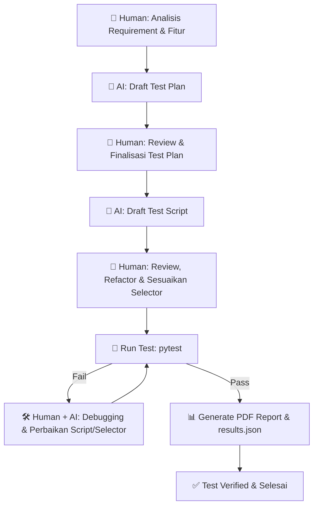

https://github.com/zulfikarreyhan/playwright-onboard.git

# 🧪 Playwright Python Automation Testing

Repositori ini menerapkan alur kerja pengujian otomatis (*Automated QA Testing Workflow*) menggunakan **Playwright dengan Python** untuk pengujian *end-to-end (E2E)* pada **Arena Reservation Management**.

Repo ini juga dipakai sebagai bahan belajar untuk **QA Automation Intern**: belajar Playwright + Pytest sambil mempraktikkan alur kerja nyata — mulai dari analisis fitur, membuat test plan, sampai menulis test script — dan memanfaatkan AI (Claude Code / AI assistant lain) supaya prosesnya lebih cepat.

---

## 📌 Alur Kerja (Workflow Diagram)



> AI mempercepat draft awal (test plan & script), tapi **manusia tetap yang review, verifikasi terhadap aplikasi asli, dan bertanggung jawab atas hasil akhirnya.** Jangan langsung commit hasil AI tanpa dicek.
> 

---

## 📁 Struktur Direktori

```
playwright-onboard/
├── data/               # Konfigurasi & kredensial dinamis (config.py, account_development.py, account_staging.py)
├── test-plan/          # Dokumentasi skenario pengujian, dikelompokkan per fitur
│   ├── TEMPLATE.md     # Template test plan — copy ini setiap membuat test plan baru
│   ├── login/
│   │   └── test-login.md
│   └── dashboard/
│       └── test-dashboard.md
├── test-scripts/       # Script pengujian Playwright (Python), dikelompokkan per fitur
│   ├── TEMPLATE_test.py  # Template test script — copy ini setiap membuat test script baru
│   ├── login/
│   │   └── test_login.py
│   └── dashboard/
│       └── test_dashboard.py
├── utils/              # Helper & fungsi terpakai ulang (playwright_helpers.py)
├── conftest.py         # Fixtures global (browser, context, page, base_url)
├── pytest.ini          # Konfigurasi Pytest (base-url, browser, timeout)
├── requirements.txt
└── README.md           # Dokumentasi workflow & petunjuk penggunaan
```

> 💡 File berawalan `TEMPLATE` sengaja **tidak** diawali `test_`, jadi tidak akan pernah ikut dijalankan oleh `pytest`. Copy dulu ke folder fitur dengan nama yang benar sebelum diisi.
> 

---

## 📦 Prasyarat & Instalasi

### Prasyarat

Sebelum memulai, pastikan perangkat Anda telah terinstal:

- **Python**: v3.9 atau yang lebih baru
- **pip**: Manajer paket Python
- **Git**

### Instalasi

1. Clone & masuk ke direktori proyek:

```bash
git clone <url-repo-ini>
cd playwright-onboard
```

1. Buat dan aktifkan *virtual environment* (**wajib** — jangan install package secara global, supaya versi dependency setiap orang konsisten):

macOS / Linux:

```bash
python3 -m venv .venv
source .venv/bin/activate
```

Windows (PowerShell):

```powershell
python -m venv .venv
.venv\Scripts\activate
```

> Tanda `(.venv)` di depan prompt terminal berarti venv sudah aktif. Aktifkan venv ini setiap kali membuka terminal baru untuk kerja di repo ini.
> 
1. Instal dependencies dan browser Playwright:

```bash
pip install -r requirements.txt
playwright install
```

1. Verifikasi instalasi (harus muncul daftar test tanpa error):

```bash
pytest --collect-only
```

---

## 🔄 Tahapan Workflow Pengujian

### Tahap 1: Pembuatan Test Plan (Dibantu AI)

1. Pahami dulu fitur yang mau diuji: buka aplikasinya, coba alur normalnya, catat field/tombol/pesan yang muncul.
2. Copy `test-plan/TEMPLATE.md` ke `test-plan/<nama-fitur>/test-<nama-fitur>.md`.
3. Minta AI membuatkan draft-nya. Contoh prompt (jalankan di Claude Code dengan template & contoh sudah ada di repo):
    
    > "Buatkan test plan untuk fitur **<nama fitur>** di `test-plan/<nama-fitur>/test-<nama-fitur>.md`.
    Ikuti format `test-plan/TEMPLATE.md` dan gaya penulisan `test-plan/login/test-login.md`.
    Fitur ini punya alur: <jelaskan alur, field, tombol, pesan error yang kamu temukan tadi>.
    Sertakan positive case, negative case, dan edge case."
    > 
4. **Review manual** hasil draft AI: cek lagi ke aplikasi, pastikan field/pesan/URL yang disebutkan benar-benar sesuai kenyataan (AI bisa menebak/berhalusinasi).
5. Finalisasi test plan sebelum lanjut ke Tahap 2.

**Format Dokumentasi Test Plan:**

- **Preconditions & Test Data**
- **Positive Test Cases** (Happy Path)
- **Negative Test Cases** (Validasi, Salah Input, Unauthorized)
- **Edge Cases / Boundary Tests**
- **Expected Results** pada setiap step

---

### Tahap 2: Menulis Test Script (Dibantu AI)

1. Copy `test-scripts/TEMPLATE_test.py` ke `test-scripts/<nama-fitur>/test_<aksi>_<nama-fitur>.py`.
2. Minta AI membuatkan draft script berdasarkan test plan yang sudah difinalisasi. Contoh prompt:
    
    > "Buatkan test script Playwright + Pytest untuk `test-plan/<nama-fitur>/test-<nama-fitur>.md`, simpan di
    `test-scripts/<nama-fitur>/test_<aksi>_<nama-fitur>.py`. Ikuti pola di `test-scripts/TEMPLATE_test.py` dan
    gaya `test-scripts/login/test_login.py` (satu fungsi test per Test Case ID, pakai `get_by_role`/`get_by_label`,
    pakai fixture `page` dari conftest.py, ambil credential dari `data/account_development.py`, jangan hardcode
    password di script)."
    > 
3. **Jalankan test-nya** dan lihat mana yang gagal — kemungkinan besar karena selector/locator dugaan AI tidak sama persis dengan aplikasi asli.
4. Kalau perlu, rekam interaksi asli dengan `codegen` untuk mendapat selector yang akurat, lalu minta AI merapikannya mengikuti pola TEMPLATE (assertion, fixture, helper), bukan dipakai mentah-mentah:

```bash
playwright codegen --target python -o /tmp/codegen-draft.py <https://arena-cms-dev.qode.biz.id/>
```

> **Catatan:** Hasil `codegen` itu draft mentah. Selalu *refactor* dulu (locator yang robust, assertion yang jelas, ikut pola TEMPLATE) sebelum dianggap final — jangan commit hasil rekaman apa adanya.
> 
1. Set credential environment variables sebelum menjalankan test (**jangan pernah** menulis password langsung di script atau test plan):

macOS / Linux:

```bash
export ARENA_USERNAME="your-email"
export ARENA_PASSWORD="your-password"
```

Windows (PowerShell):

```powershell
$env:ARENA_USERNAME = "your-email"
$env:ARENA_PASSWORD = "your-password"
```

---

### Tahap 3: Eksekusi Test & Laporan (PDF Report)

Jalankan perintah pengujian sesuai kebutuhan:

```bash
# Menjalankan seluruh test (PDF report di-generate otomatis ke reports/<timestamp>/)
pytest

# Menjalankan file test spesifik
pytest test-scripts/login/test_login.py

# Menjalankan dengan mode browser terbuka (Headed) — enak buat debugging
pytest --headed

# Filter berdasarkan marker
pytest -m smoke
pytest -m cms
pytest -m web
```

> PDF report (`report.pdf`) dan `results.json` digenerate otomatis oleh `conftest.py` ke folder `reports/<timestamp>/` setelah setiap sesi pytest. Tidak perlu flag tambahan.

Kalau ada test yang gagal, coba jalankan `--headed` untuk melihat langsung apa yang terjadi di browser, lalu tanyakan ke AI dengan menyertakan pesan error pytest-nya — biasanya lebih cepat menemukan penyebabnya (selector salah, timing/wait, data test tidak sesuai, dsb.) dibanding menebak sendiri.

---

## 🎯 Best Practices

- **Lokasi Test & Penamaan:** Selalu kelompokkan skrip pengujian di folder `test-scripts/<nama-fitur>/` dengan awalan nama file `test_`.
- **Prioritaskan Accessibility Locators:** Gunakan `get_by_role`, `get_by_label`, `get_by_placeholder`, atau `get_by_text` ketimbang XPath kaku atau selector CSS yang rentan berubah.
- **Isolasi Data Uji:** Simpan data uji dan kredensial secara terpisah pada folder `data/` dan gunakan environment variable — **jangan pernah** hardcode password/token di kode, test plan, atau prompt AI.
- **Penggunaan Fixture & Helper:** Manfaatkan fixture global pada `conftest.py` dan buat *reusable function* pada `utils/playwright_helpers.py` kalau dipakai lebih dari satu file test.
- **Satu Test Case ID = Satu Fungsi Test:** Supaya mudah ditelusuri balik ke test plan, dan hasil report gampang dibaca.
- **AI mempercepat, bukan menggantikan verifikasi:** Selalu cek ulang draft AI (test plan maupun script) terhadap aplikasi asli sebelum dianggap final.

---

## 🛠️ Troubleshooting

- **`ModuleNotFoundError: No module named 'playwright'`** — venv belum aktif. Jalankan lagi `source .venv/bin/activate` (macOS/Linux) atau `.venv\Scripts\activate` (Windows).
- **Error `conflicting option string: --headed` saat menjalankan pytest** — ada plugin pytest lain yang bentrok (misal `pytest-playwright`) ter-install di environment yang sama. Pastikan kerja selalu di dalam `.venv` yang bersih (hanya isi `requirements.txt`), bukan environment Python global.
- **Browser tidak ditemukan / gagal launch** — jalankan ulang `playwright install`.
- **Test gagal karena elemen tidak ditemukan** — kemungkinan locator berubah karena update UI aplikasi, atau ada dialog/loading yang belum di-`expect(...).to_be_visible()` dulu sebelum interaksi berikutnya.

---

## 📄 Lisensi

Proyek ini dilisensikan di bawah **MIT License**.